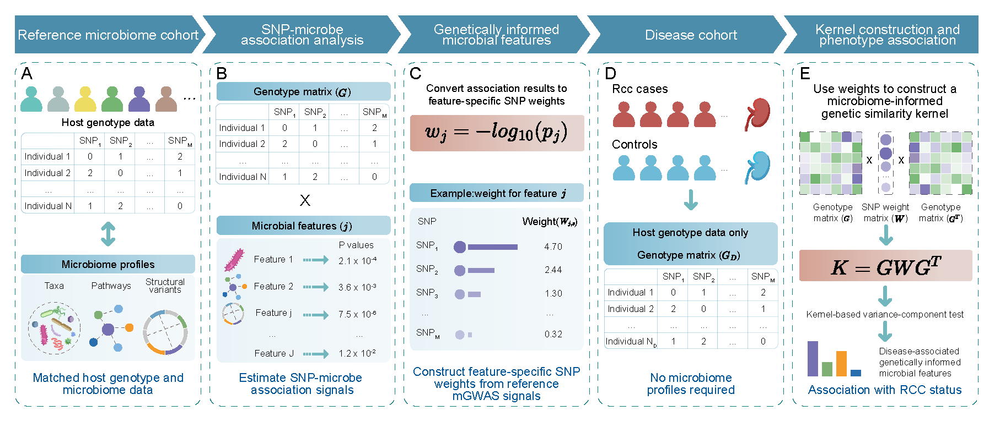

# User Manual of GIMWAF (Version 1.0)

Genetically Imputed Microbiome-Wide Association Framework (GIMWAF) is the branded Java command-line tool provided by this repository. The current Java workflow, input arguments, and dependency requirements are preserved; the executable name, CLI entrypoint, user-facing text, and release packaging are standardized around `GIMWAF`.

## Overview of GIMWAF

GIMWAF (Genetically Imputed Microbiome-Wide Association Framework) is a framework designed to link host genetic variants to microbiome-mediated disease risk, leveraging individual-level genotype and microbiome trait data. GIMWAF comprises three key components.

- Marginal Screening:  
  In the first phase, GIMWAF identify SNPs associated with specific microbial features—including taxonomy, pathway, and structural variants—using univariate linear models. This approach preserves weak but potentially polygenic signals across the genome.
- Construction of Microbiome-Informed Genetic Kernels Matrices:  
  Instead of modeling SNP effects independently, GIMWAF constructs microbiome-informed genetic similarity kernels that aggregate the marginal effects of selected SNPs, weighted by their association strength. This kernel matrix serves as a data-driven representation of host genetic variation relevant to each microbial trait.
- Variance-Component Score Testing:  
  Finally, GIMWAF applies a variance-component score test to evaluate whether genetically imputed microbiome variation is associated with the disease phenotype.  
  This framework enables a powerful, integrative approach to uncovering host–microbiome interactions underlying complex diseases.




## Install

GIMWAF is a batteries-included JAR executable. All needed external jar packages are included in the downloadable, `GIMWAF.jar`

- To download all necessary files, users can use the command

```bash
git clone https://github.com/lfssw/GIMWAF.git
```

## Required Software and R Packages

- PLINK v1.9 (<https://www.cog-genomics.org/plink/>)
- R software (<https://www.r-project.org/>)
- SKAT >= 2.2.5 (<https://cran.r-project.org/web/packages/SKAT/index.html>)

## Usage of GIMWAF

```bash
java -jar GIMWAF.jar GIMWAF -format plink|csv -input_genotype path/to/example.tped|example.csv -input_phenotype path/to/example.tfam|example.tsv -input_phenotype_column 6|2 -input_phenotype_type continuous|binary -summary_info path/to/summary_info.txt -microbe Anaerostipes_hadrus_2388_2402 -plink path/to/plink -Rscript path/to/Rscript -output_folder path/to/output_folder
```

## Arguments

- `format`: the format of genotype and phenotype data, `plink` or `csv`.
- `input_genotype`: genotype file.
- `input_phenotype`: phenotype file.
- `input_phenotype_column`: the column of phenotype in the phenotype file.
- `input_phenotype_type`: the type of phenotype, `continuous` or `binary`.
- `summary_info`: summary information file between SNPs and the modeled feature set.
- `micro`: the microbial feature.
- `plink`: PLINK command path.
- `Rscript`: Rscript command path.
- `output_folder`: output directory path.

## Examples

```bash
java -jar GIMWAF.jar GIMWAF -format csv -input_genotype EXAMPLE/csv_format/example.csv -input_phenotype EXAMPLE/csv_format/example.tsv -input_phenotype_column 2 -input_phenotype_type binary -summary_info SUMMARY_EXAMPLE/summary_info_example.txt -microbe Anaerostipes_hadrus_2388_2402 -plink path/to/plink -Rscript path/to/Rscript -output_folder path/to/output_folder
```

```bash
java -jar GIMWAF.jar GIMWAF -format plink -input_genotype EXAMPLE/plink_format/example.tped -input_phenotype EXAMPLE/plink_format/example.tfam -input_phenotype_column 6 -input_phenotype_type binary -summary_info SUMMARY_EXAMPLE/summary_info_example.txt -microbe Anaerostipes_hadrus_2388_2402 -plink path/to/plink -Rscript path/to/Rscript -output_folder path/to/output_folder
```

## Notes

- To stay consistent with PLINK format, the phenotype is set to missing (normally represented by `-9`) if unspecified. It must be numeric.
- Case/control phenotypes are normally coded as control `= 1`, case `= 2`.
- The summary information file requires format conversion.The first column contains microbial features, followed by columns of merged significant SNP information.The segment after the final underscore in each column represents -log₁₀(p-value).
- The association result file written under `path/to/output_folder` is `GIMWAF.result`.

## Citations

If you use the software implementation in analysis, please cite the original manuscript associated with this codebase:

**GIMWAF: A genetically informed microbiome-wide association framework identifies microbial features associated with renal cell carcinoma, Fei Li, Guoli Xiao, Min Tian, Yulin Yue, Chen Cao.**

## Contacts

Fei Li: <lifeiwsy@outlook.com>

Chen Cao: <caochen@njmu.edu.cn>

## License

MIT License.
